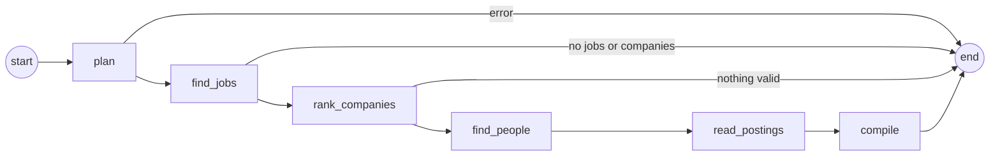

# Plan: the search agent as an enforced LangGraph pipeline (+ ranking, on-demand people)

Requests:

1. *"instead of leaving it up to the agent, make the agentic portion a LangGraph pipeline so
   that each step is enforced."*
2. (scope change) *"only find people to connect with for the top-3 highest ranked candidates
   (the backend should internally score the results and display them in ranked order). Below
   every company + job posting, there should be a button called "Find People To Connect
   With" that searches for people to connect with at a job if the person is interested in it.
   These searches can be run in parallel if the user clicks multiple buttons in a row."*

## Why

`agent.run_search` ran a free-form `create_agent` tool-calling loop (Haiku, `RESEARCH_PROMPT`)
and then one structured-output compile call over the transcript. The model often stopped
after ~3 tool calls and skipped people searches:

| Saved search | Companies | Companies with 0 people |
|---|---|---|
| Conservation jobs related to data · New York | 4 | **4** |
| Software engineering roles in New York | 5 | **1** (New York Life) |

The compile step could also add companies that never got a people search, because it read a
free-form transcript.

## Graph

Each step is a `StateGraph` node. The LLM only decides *what* to search for, *how well*
companies fit, and writes the text; code decides *that* every search runs.



| Node | Kind | Reads | Writes |
|---|---|---|---|
| `plan` | LLM, structured (`SearchPlan`), purpose `plan` | `request` | `plan` |
| `find_jobs` | code | `plan` | `jobs`, `listed_companies` |
| `rank_companies` | LLM, structured (`CompanyRanking`), purpose `rank_companies`; validated in code | `request`, `plan`, `jobs`, `listed_companies` | `chosen` (scored, sorted) |
| `find_people` | code, runs for **every one of the top `PEOPLE_AUTO_COMPANIES` (3)** | `plan`, `chosen` | `people` |
| `read_postings` | code, optional (`READ_POSTINGS`, default 2) | `chosen` | `postings` |
| `compile` | LLM, structured (`SearchResults`), purpose `compile_results`; restricted in code | everything above | `results` |

Every node appends to `trace` and emits status lines. A fatal problem sets `error` and the
conditional edges route to the end.

Outside the graph, `pipeline.on_demand.find_people` serves the "Find People To Connect With"
button with the same people-search code plus one small LLM call (purpose
`find_people_on_demand`).

## State (`pipeline/state.py`)

```python
class PipelineState(TypedDict, total=False):
    request: SearchRequest
    plan: SearchPlan
    jobs: list[Job]                        # every posting found, ids "j1", "j2", ...
    listed_companies: list[ListedCompany]  # BuiltIn company search results, if planned
    chosen: list[ChosenCompany]            # validated, scored, best first (<= MAX_COMPANIES)
    people: dict[str, list[Person]]        # company name -> people; key present = searched
    postings: dict[str, str]               # job url -> posting text (read_page)
    results: SearchResults
    error: str                             # fatal: nothing usable
    trace: Annotated[list[TraceStep], operator.add]
```

LLM schemas keep every field required, use few nullable fields, and put list limits in the
descriptions (code enforces them), so they work with `method="json_schema"`:

- `SearchPlan`: `role_titles` (2-3), `seniority`, `industries`, `location`,
  `people_location` (city for people searches, or ""), and one list per source:
  `builtin_jobs: list[BuiltinJobQuery]`, `builtin_companies: list[BuiltinCompanyQuery]` (at
  most 1 used), `conservation_jobs: list[ConservationJobQuery]`, `google_queries:
  list[str]`. An empty list means "don't use this source". The source-selection rules from
  `RESEARCH_PROMPT` moved to `PLAN_PROMPT`.
- `CompanyRanking`: `companies: list[RankedCompany]`, each `name`, `score` (0-100),
  `reason`, `jobs: list[{id, score}]` (ids from the jobs table), `people_keywords` (1-2).
- `PeopleNotes`: `people: list[PersonResult]` (on-demand only).

Gathered data is typed: `Job`, `ListedCompany`, `ChosenCompany` (name, url, about, score,
reason, jobs, job_scores, people_keywords), `Person` (name, headline, title, company,
at_company, location, url, snippet, keywords).

## Nodes in detail

### 1. plan

Profile in, `SearchPlan` out. Caps: 3 BuiltIn job queries, 1 BuiltIn company query, 3
conservation queries, 2 Google queries, 3 role titles. If no source was chosen, code adds one
Google query (`"<first role>" jobs <location>`).

### 2. find_jobs

Runs every planned query in order through the shared functions in `tools.py`
(`builtin_jobs`, `builtin_companies`, `conservation_jobs`, `google_search`), the same code the
old tools wrapped. Google calls go through the one shared Chrome worker. The node is
sequential (BuiltIn/Conservation calls are fast next to Google).

- Each call is one trace step; an error is recorded, reported as a status line, and skipped.
- Jobs are de-duplicated by normalized URL (`entities.keys.normalize_url`) and numbered.
- **Enforced fallback** (replaces "if BuiltIn returns little, use google_search"): fewer
  than 5 jobs and no Google query planned → one Google query.
- No jobs and no listed companies → `error`.

### 3. rank_companies (ranking)

The LLM sees the profile, the plan and a compact jobs table (id, source, title, company,
location, salary, short summary; URL only for Google results) plus listed companies. It
returns up to `MAX_COMPANIES` (6) companies, each with an overall **score 0-100**, a one-line
reason, its relevant jobs each with its own score, and people keywords.

`validate_ranking` (code):

- A job id must exist and, if the job names its company, match the pick (normalized).
- A pick is kept only with at least one valid job or a name that appears in the data (a
  job's company or a listed company). The data's spelling wins. Duplicates are dropped.
- Scores are clamped to 0-100. Companies are sorted by score, ties broken by number of
  relevant jobs (the only deterministic signal blended in; location and source are already
  part of the LLM's judgement). Jobs inside a company are sorted by their score.
- If the call fails or nothing valid remains, `default_ranking` ranks companies by number
  of postings (score `40 + 10 × postings`, max 80). Only if that is empty too: `error`.

Dropped picks and ids are listed in a `validate` trace step.

### 4. find_people (top companies only; the fallback ladder)

For **each of the top `PEOPLE_AUTO_COMPANIES` (3)** companies, in rank order:

1. each planned keyword set, with `people_location`;
2. `"recruiter"`, with `people_location` (skipped if it duplicates a rung);
3. company name only: no keywords, no location (broadest).

Each rung calls `tools.linkedin_people(company, keywords, location, n=PEOPLE_SEARCH_N)`,
which keeps the existing retry when Google ignores `site:linkedin.com/in` (6 s pause,
operator moved to the end, the ignored page not cached) and raises if Google still ignores
it. People are de-duplicated by profile URL. The ladder stops once `PEOPLE_PER_COMPANY` (3)
current employees (`at_company`) were found, or runs out. A rung that errors is recorded and
the next rung runs. The other companies get `people: []` and `people_searched: false`.

### 5. read_postings

`read_page` on the best job of the first `READ_POSTINGS` (2; `0` = off) ranked companies
with jobs, `max_chars=READ_POSTING_MAX_CHARS` (4000). Errors are recorded and skipped.

### 6. compile

Input is only the gathered data as JSON (no transcript): profile, and per ranked company its
URL, about text, ranking note, jobs (with `posting_text` when read), `people_searched` and
people (with `at_company`). System prompt: `prompts.compile_prompt()` (results rules +
LinkedIn note rules). Alignment and `connect_message` are therefore only written for the top
companies' people.

`restrict_results` (code):

- companies: only chosen ones (normalized name), chosen spelling, no duplicates; a chosen
  company the LLM left out is added back from gathered data (empty alignment), so a top-3
  company never loses its people;
- jobs: only that company's gathered jobs, by normalized URL else exact title; gathered URL
  written back; job `score` from the ranking; sorted by score;
- people: only that company's found people, by normalized profile URL else name; found URL
  written back;
- company URL: the LLM's if it is one of that company's gathered URLs, else the known company
  URL, else the first job URL;
- `score`, `people_searched` and `people_keywords` set from the ranking; companies sorted by
  score.

Counts of dropped/added items go into a `validate` trace step. Ex-employee skipping stays a
prompt rule (`at_company` is a heuristic).

## Schema changes (backward compatible)

- `CompanyResult.score: int | None = None`, `people_searched: bool = False`,
  `people_keywords: list[str] = []`; `JobResult.score: int | None = None`. All are
  `SkipJsonSchema`, so the LLM never writes them; old saved searches load with the defaults.
- `SavedSearch.trace: list[TraceStep] | None = None`.
- `TraceEvent` (server-internal) and `FindPeopleRequest`.

## On-demand "Find People To Connect With"

`POST /api/searches/{search_id}/people` with `{"company_key": "...", "job_key": "..." | null}`
→ the updated `CompanyResult` (keyed). 404 if the search, company or job isn't found.

1. Load the saved search, find the company (and job) by entity key.
2. Ladder keywords: the job's title first (when given), then the company's saved
   `people_keywords`, then "recruiter", then company only. Location: the city part of the
   search's location ("New York, NY" → "New York"). People already on the company are
   skipped, so a second click finds new people.
3. If anyone was found: one structured LLM call (`PeopleNotes`, `prompts.people_notes_prompt()`,
   purpose `find_people_on_demand`) writes alignment and `connect_message`, restricted to the
   found people with `match_people`. If it fails, current employees are saved without notes.
4. `history.update_search` merges under a per-search lock: re-read the file, add people not
   already there (by person key), set `people_searched`, append the trace steps, write
   atomically. Different searches don't block each other.
5. The People page shows the new people through the existing entities aggregation (it reads
   the saved searches).

### Concurrency

- The endpoint is a plain `def`, so FastAPI runs it in its threadpool: several requests (for
  different companies, or the same one twice) are processed at once and the event loop is
  never blocked. There is no global request lock.
- Google searches (the slow part) go through the single shared Chrome worker: one thread,
  one persistent profile. Parallel requests therefore **queue their Google pages** in that
  worker; everything else (reading the search, the LLM call, saving) runs in parallel.
- Only the final read-modify-write of one saved search is serialized (per-search
  `threading.Lock`), and it is fast. Writes go through a unique temp file + `os.replace`,
  retried briefly on Windows if a reader holds the file.
- Several Google pages concurrently in one browser context (multiple tabs) was considered
  and not done: it is one profile and one Google session, so concurrent pages look like a
  burst to Google (the `/goto` throttle and CAPTCHA risk are per session, see
  `docs/google-serp-speed/findings.md`), and Playwright's sync API would need one thread per
  page or an async rewrite of the worker. The queue keeps the behaviour that is known to work.
- `accounts.ensure_user` now creates the user record under a lock (concurrent first
  requests could read a half-written `user.json`).

### Frontend

- `findPeople(searchId, companyKey, jobKey?)` in `api.ts`.
- `components/find-people-button.tsx`: a secondary `Button` with its own loading state
  (spinner, "Finding people…", `aria-busy`) and its own error with a Retry button, so several
  can run at once. Disabled until the search is saved (needs the search id).
- Results page: a button below every company card ("Find more people" once it has people)
  and below every job ("Find People To Connect With", with that job). A "Fit NN" chip shows
  the score; the rank number was already shown. "No current employees found yet." tells a
  searched-but-empty company apart from a not-yet-searched one.
- `App.tsx` swaps the returned company into the results (only if that search is still on
  screen) and refreshes the entity pages.
- Companies / Jobs entity pages: **not added**. Those pages don't show people under a
  company or job, so there is nowhere to "insert the people under that company"; the button
  would only change a count. The data would support the call (`searches[0].id` + key). The
  new people do appear on the People page.

## Events (unchanged contract)

`run_search(request, llm=None)` yields `StatusEvent`s while the graph runs (LangGraph custom
stream writer), then `TraceEvent` + `ResultEvent`, or one `ErrorEvent` if nothing usable was
found. The server keeps `TraceEvent` for saving and never sends it to the browser. Example:

```
Reading your profile
Planning: Data Analyst, Analytics Engineer (mid level)
Searching BuiltInNYC jobs for “data analyst”
BuiltInNYC jobs for “data analyst”: 15 jobs
Searching Google for “...” / Google for “...” failed: RuntimeError: ...
Ranking companies from 27 jobs
Top companies: Ramp (90), Notion (80), Datadog (70), Etsy (60), Plaid (50)
Looking for data manager at Ramp
Ramp: 3 current employees found
...
Reading builtinnyc.com/job/1
Compiling your results
```

## Trace (saved with the search)

```json
{"step": "find_people", "source": "linkedin_people",
 "args": {"company": "Ramp", "keywords": "recruiter", "location": "New York"},
 "count": 4, "error": "", "duration_ms": 5321, "note": "2 current employees so far"}
```

`step`: `plan`, `find_jobs`, `rank_companies`, `find_people`, `read_postings`, `compile`,
`find_people_on_demand`. `source`: `llm`, `builtin_jobs`, `builtin_companies`,
`conservation_jobs`, `google_search`, `linkedin_people`, `read_page`, `validate`. Searches
that end in an error aren't saved (as before); their trace is logged.

## Settings (`config.py`)

`MAX_COMPANIES` (6), `PEOPLE_AUTO_COMPANIES` (3), `PEOPLE_PER_COMPANY` (3), `PEOPLE_SEARCH_N`
(5), `READ_POSTINGS` (2), `READ_POSTING_MAX_CHARS` (4000). `AGENT_RECURSION_LIMIT` removed.

## Files

- New package `backend/src/pipeline/`: `__init__.py`, `state.py`, `steps.py` (nodes and
  shared helpers), `graph.py` (wiring + `run_search`), `on_demand.py`.
- `prompts.py`: `PLAN_PROMPT`, `RANK_PROMPT`, `COMPILE_PROMPT` (reworded for gathered data,
  ranked order, `people_searched`), `PEOPLE_NOTES_PROMPT`; `RESEARCH_PROMPT` removed.
- `tools.py`: slimmed to plain source functions (no `@tool`, args models or `ALL_TOOLS`);
  they raise instead of returning `{"error": ...}` JSON.
- `schemas.py`, `userdata/history.py` (`trace`, `update_search`), `userdata/accounts.py`
  (creation lock), `server.py` (`pipeline.run_search`, trace saving, new endpoint),
  `config.py`, `requirements.txt` (`langgraph`).
- Removed: `agent.py`, `tests/test_agent.py`.
- Frontend: `api.ts`, `App.tsx`, `pages/results.tsx`, new `components/find-people-button.tsx`,
  new `pages/results.test.tsx`.

## Tests (mocked LLM and sources only)

- `tests/test_pipeline.py`: top companies get a people search and the rest are marked not
  searched; ranking order (companies and jobs); ladder climbs on empty results, stops early,
  records errors; compile can't add companies/jobs/people and URLs are repaired; ranking
  validation and its fallback; a failing source degrades; nothing found → one error; plan
  and compile failures; event order; compile input is gathered data only.
- `tests/test_find_people.py`: merge + `people_searched`, job title as first keywords, trace
  appended, no duplicates on a second run, LLM failure fallback, nobody found, 404s, People
  page, concurrent requests with slow fakes don't lose writes and really overlap, endpoint
  is a threadpool `def`.
- `tests/test_server.py`: trace saved but not streamed; old saved searches load.
- `tests/test_llm_usage.py`: one usage row per LLM node (`plan`, `rank_companies`,
  `compile_results`), tagged with user/search.
- `frontend/src/pages/results.test.tsx`: ranked order + score, the button calls the API
  (company and job), two parallel clicks with independent loading states and people
  inserted, "nobody found", per-button error + retry, disabled until saved.

## Tradeoffs

- **LLM calls per search:** always 3 (plan, rank, compile), vs 4-17 before (one per agent
  turn plus compile). Plan and rank prompts are small; compile input is smaller than a
  transcript. Each on-demand click adds 1 call.
- **Latency:** dominated by Google. People searches now run for 3 companies (1-3 rungs
  each) instead of whatever the agent chose; the ladder only adds calls when a company has
  too few people. On-demand searches queue behind each other in the Google worker, so 3
  clicks take about 3× one search, but the UI stays responsive and each button resolves
  separately.
- **Less adaptive:** no re-querying after a bad result beyond the fixed fallbacks.
- **Deferred:** parallel BuiltIn/Conservation/read_page calls alongside Google; an LLM
  "replan" when a step finds nothing; a trace UI; buttons on the Companies/Jobs pages.
